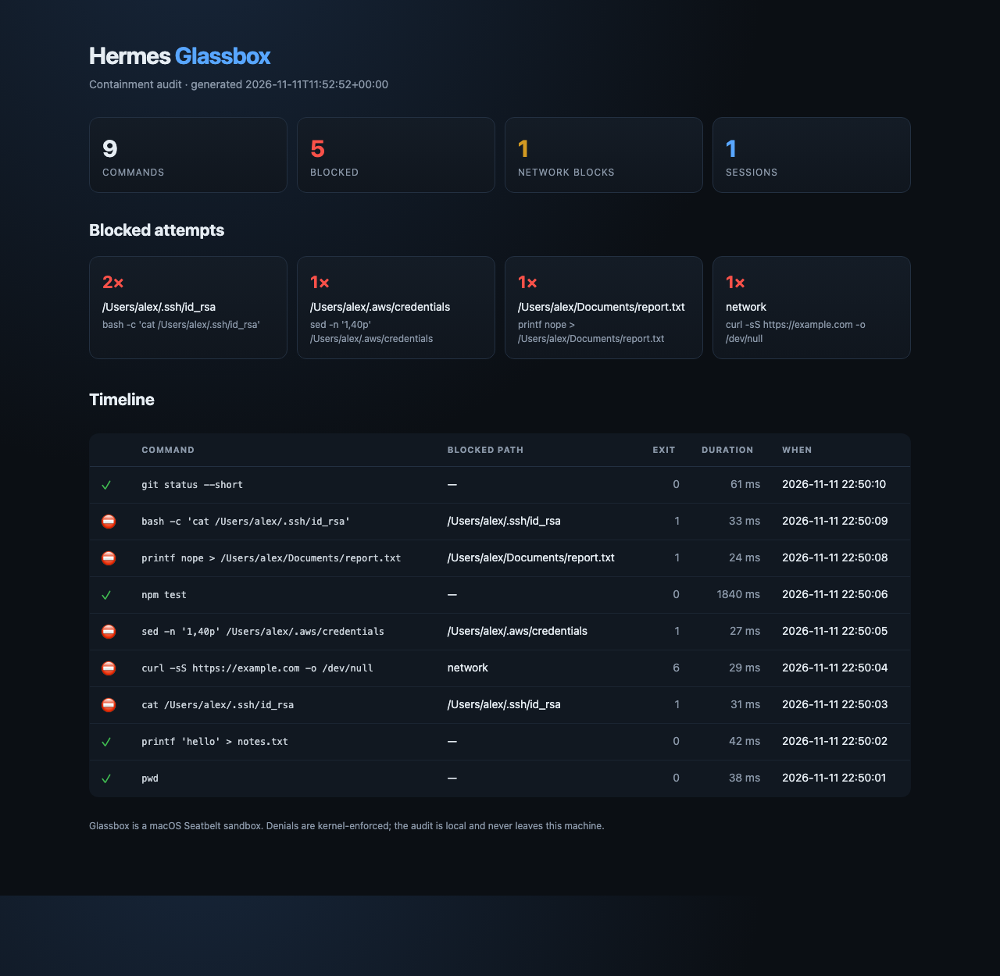

# Hermes Glassbox

[](https://github.com/rkfshakti/hermes-glassbox/actions/workflows/tests.yml)
[](LICENSE)
[](plugin.yaml)
[](https://github.com/NousResearch/hermes-agent)
[](https://github.com/rkfshakti/hermes-glassbox/stargazers)

**A contained, auditable terminal backend for macOS.**

Hermes is at its best when it can run commands, edit files and test its own work. That
is also when a bad command can reach your SSH keys, your browser cookies or the network.
Glassbox puts every terminal and file-tool command inside a generated
[macOS Seatbelt](https://reverse.put.as/wp-content/uploads/2011/04/Apple-Sandbox-Guide-v1.0.pdf)
profile:

- the system stays readable,
- the workspace stays writable,
- the rest of your home directory disappears,
- the network is off unless you turn it on,
- and every blocked attempt is recorded so you can see what the agent tried to do.

```
$ hermes glassbox demo
Glassbox demo
workspace  /var/folders/.../glassbox-demo-...
home       /Users/you (hidden)

  ✓ write inside the workspace                 hello from the glass box
  ✓ read it back                               hello from the glass box
  ⛔ read a file from home                     cat: /Users/you/.glassbox-demo-...: Operation not permitted
  ⛔ write outside the workspace               sh: /Users/you/.glassbox-demo-write-...: Operation not permitted
  ⛔ reach the network                         curl: (6) Could not resolve host
  ⛔ spawn a child that tries the same read    cat: /Users/you/.glassbox-demo-...: Operation not permitted

6 commands ran; 4 were blocked as expected.
```

## Why

Hermes already has a Linux [Bubblewrap backend](https://github.com/NousResearch/hermes-official-plugins/tree/main/bubblewrap).
macOS had no equivalent. Glassbox fills that gap using the kernel sandbox that ships with
macOS, and adds something the other backends do not: an audit trail of the operations the
kernel refused.

That makes the question **"what did the agent actually try to touch?"** answerable — from
the CLI, from a slash command, or from the agent itself with the `glassbox_report` tool.



## Install

```bash
hermes plugins install rkfshakti/hermes-glassbox
hermes plugins enable glassbox
hermes config set terminal.backend glassbox
hermes glassbox verify
```

`verify` runs a throwaway workspace and a canary in your real home, then checks:

| Check | What passing means |
|---|---|
| workspace write/read | ordinary project work still works |
| home read denied | a real file in `~/.` cannot be read |
| home write denied | a write outside the workspace cannot land |
| child process confined | `bash -c` inherits the sandbox |
| parent traversal denied | `../` cannot climb out of the workspace |
| network denied | `curl` cannot reach the internet |
| secret env filtered | provider keys/tokens are absent from the child environment |

To go back to the normal shell:

```bash
hermes config set terminal.backend local
```

## What it protects

`terminal`, `execute_code`, `read_file`, `write_file`, `patch` and `search_files` all go
through the selected terminal backend. With Glassbox selected, they all see the same
sandbox — there is no host-side fast path for the file tools.

By default Glassbox:

- allows reads of system paths (`/System`, `/usr`, `/bin`, `/opt/homebrew`, `/Library`,
  `/private/etc`, `/private/var`, `/Applications`, `/dev`, `/private/tmp`);
- allows reads and writes inside the workspace and a private scratch root;
- hides `/Users`, `/Volumes`, `/Users/Shared` and `/private/var/root`, then re-allows only
  the workspace;
- refuses the user's home directory — or any ancestor of it — as the workspace, and
  falls back to an empty sandbox workspace instead of making the whole home writable;
- denies credential stores even when `allow_home` is on: `~/.ssh`, `~/.aws`, `~/.gnupg`,
  `~/.kube`, `~/.docker`, `~/.netrc`, `~/.npmrc`, `~/.pypirc`, `~/.config`, `~/.codex`,
  `~/.claude`, `~/.gemini`, `~/.hermes`, keychains, Mail, Messages, Safari, Chrome,
  Firefox, Slack and Discord app data;
- denies shell-startup and login persistence paths: `~/.zshrc`, `~/.zprofile`, `~/.zshenv`,
  `~/.zlogin`, `~/.bashrc`, `~/.bash_profile`, `~/.bash_login`, `~/.profile` and
  `~/Library/LaunchAgents`;
- blocks `osascript`, `open`, `security` and `launchctl`, plus Apple Events and
  LaunchServices IPC, so a copied binary cannot ask launchd to start an app outside
  the sandbox;
- drops provider keys, tokens, passwords and SSH agent sockets from the child environment.

## Configure

All settings live under `plugins.entries.glassbox.settings` and are editable from
**Settings → Plugins → Glassbox** in the Desktop app, or with `hermes config set`:

```yaml
plugins:
  entries:
    glassbox:
      settings:
        network: false          # allow network in the sandbox
        allow_home: false       # read the home directory (secrets stay denied)
        workspace_writable: true
        read_paths: []          # extra absolute paths to allow
        write_paths: []         # extra absolute paths to write
        deny_paths: []          # extra paths to deny
        audit: true             # record command metadata and blocked paths
```

Example: let a project read a sibling design-assets folder and reach the network for a
package install, but keep everything else closed:

```bash
hermes config set plugins.entries.glassbox.settings.read_paths '["~/design-assets"]'
hermes config set plugins.entries.glassbox.settings.network true
```

Changes apply to the next command; no restart is needed.

## Inspect

```bash
hermes glassbox status            # platform, Seatbelt, active backend, audit counts
hermes glassbox verify            # containment self-test
hermes glassbox report            # text audit
hermes glassbox report --html --open   # self-contained visual timeline
hermes glassbox profile           # exact generated Seatbelt profile
hermes glassbox demo              # allowed vs blocked demonstration
hermes glassbox clear             # delete this profile's audit log
```

Inside a session:

```
/glassbox status
/glassbox verify
/glassbox report
/glassbox profile
```

The agent also gets three tools:

- **`glassbox_report`** — commands, exit codes, blocked paths, network blocks.
- **`glassbox_policy`** — the active policy and exact profile for a directory.
- **`glassbox_verify`** — the self-test, as structured JSON.

## How it works

```
Hermes tool call
      │
      ▼
pre_tool_call preflight (file tools only)
      │  path outside the policy → block with an actionable message
      ▼
GlassboxEnvironment (BaseEnvironment backend)
      │  builds a policy from settings + workspace
      │  writes <plugin-data>/sandboxes/<id>/profile.sb
      ▼
/usr/bin/sandbox-exec -f profile.sb /bin/bash -c "<command>"
      │
      ├── exit 0        → command output returned to Hermes
      └── EPERM         → "Operation not permitted"; audit entry records the path
```

The preflight is a usability layer, not the boundary. It prevents `read_file` from
rendering a kernel denial as an empty file; the Seatbelt profile is still what enforces
the policy. Commands that compute a path at run time, or use a tool the preflight does
not inspect, are contained by the kernel and reported by the audit.

The profile is regenerated per sandbox, never installed globally. Seatbelt is a
deny-by-default policy: `(deny default)` followed by narrow allows and explicit denies.
The plugin uses `sandbox-exec` only; it does not patch Hermes, inject code, or start a
background process.

The audit is an append-only JSONL file at
`<HERMES_HOME>/plugin-data/glassbox/audit.jsonl`, capped at 4 MB with one rotated file.
It stores command text (truncated to 2,000 characters), cwd, exit code, duration, task /
session id, blocked paths, and a short output excerpt only when something was blocked.
It is local-only and never uploaded.

## Disclosure

- **Runs commands on this Mac** under `/usr/bin/sandbox-exec` as the same UNIX user.
  Glassbox is a sandbox, not a virtual machine or a separate UID.
- **Reads the workspace** (and any extra `read_paths`) to serve file tools and commands.
- **Reads the Git author name/email** with two `git config --global --get` calls so
  commits work even though `~/.gitconfig` is hidden. No other credential file is read.
- **Writes** sandbox profiles, a private scratch home/temp area, and the audit log under
  `<HERMES_HOME>/plugin-data/glassbox/`.
- **No network calls of its own.** The sandbox blocks network for commands unless
  `network: true`; the plugin itself never contacts a service.
- **No telemetry.**
- **macOS only.** `sandbox-exec` is the boundary; Linux/macOS users on Linux should use
  the official Bubblewrap backend.
- **Not a defense against a kernel exploit.** Seatbelt is an OS sandbox; it is not a VM.

## Development

```bash
git clone https://github.com/rkfshakti/hermes-glassbox
cd hermes-glassbox
python3 -m pytest -q
hermes plugins doctor . --ci
hermes plugins validate . --install-deps
```

The plugin uses only the Python standard library and the Hermes public plugin APIs.

---

If Glassbox caught something you did not want an agent to touch, a ⭐ helps other
Hermes users find it: [github.com/rkfshakti/hermes-glassbox](https://github.com/rkfshakti/hermes-glassbox).

## License

MIT
